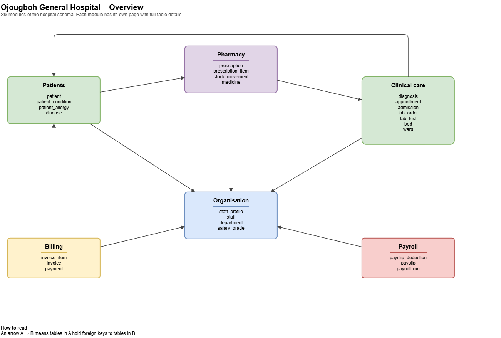
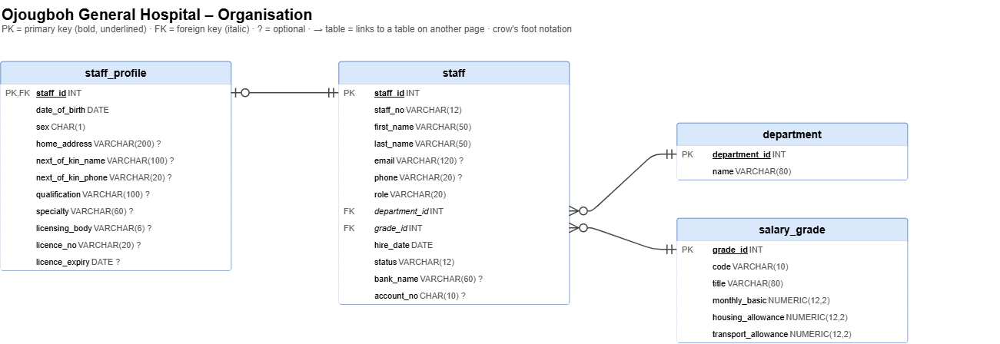
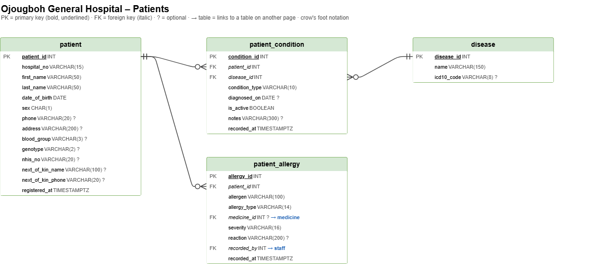
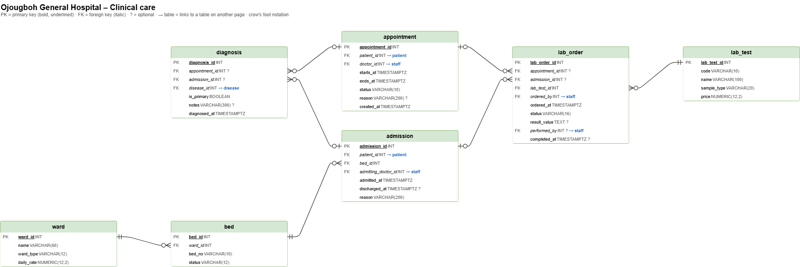
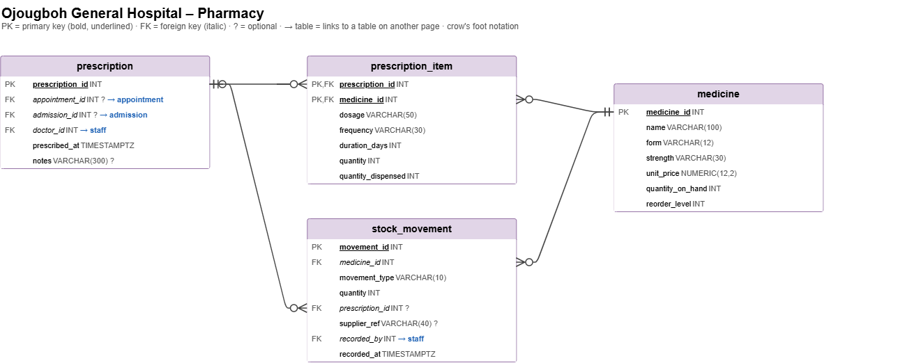
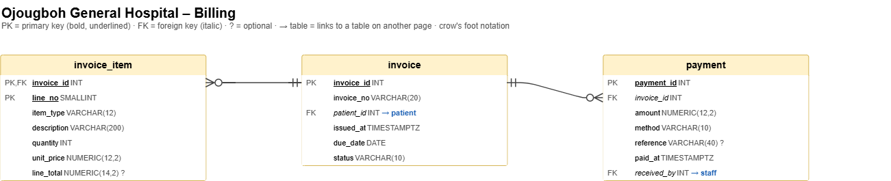
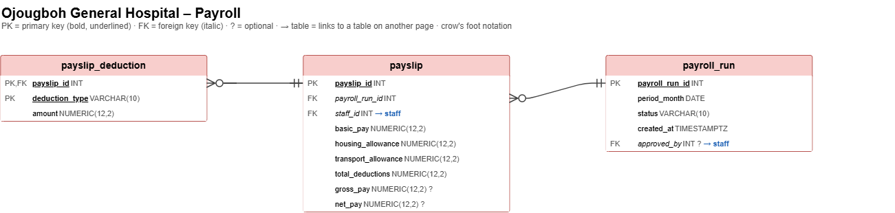
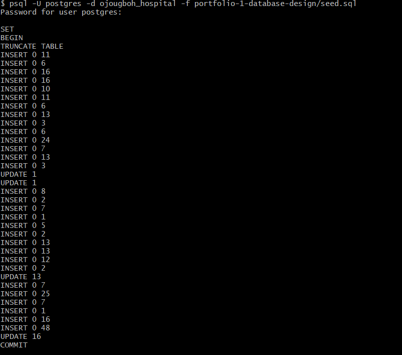
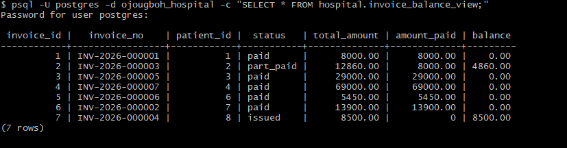

# Portfolio 1 – Database Design and Modelling

## 1. Case study: Ojougboh General Hospital

**Organisation.** Ojougboh General Hospital (OGH) is a simulated large general hospital in Agbor, Delta State, Nigeria. It runs outpatient clinics across several departments, inpatient wards, a laboratory and a pharmacy. All staff are paid monthly through the hospital payroll.

**Nature of the business.** OGH provides outpatient consultations, inpatient admission, laboratory testing and dispensing of medicines. Patients are billed for each service and pay by cash, POS, bank transfer or through their NHIS (National Health Insurance) cover.

**Users of the database.**

| User | What they do in the system |
|------|----------------------------|
| Front desk / records officers | Register patients, book and cancel appointments |
| Doctors | Record diagnoses, write prescriptions, order lab tests, admit and discharge patients |
| Nurses | Assign beds, manage ward occupancy |
| Lab scientists | Record lab results |
| Pharmacists | Dispense medicines, receive and adjust stock |
| Billing officers | Raise invoices, record payments |
| HR / payroll officers | Manage staff records and salary grades, run monthly payroll |
| Management | Reports on revenue, bed occupancy, staff cost and clinical activity |

**Major data stored.**

- **Organisation:** departments, staff, staff profiles (including professional licences), salary grades
- **Clinical:** patients, their allergies and chronic or past conditions, appointments, admissions, wards and beds, diagnoses, prescriptions, lab tests and results
- **Pharmacy:** medicine catalogue, stock levels and a log of every stock movement
- **Billing:** invoices, invoice lines, payments
- **Payroll:** monthly payroll runs, payslips and deductions (PAYE tax, pension, NHF)

**Key operations the database supports.**

1. Register a patient and retrieve their full medical history
2. Book an appointment without double-booking a doctor
3. Admit a patient to an available bed and discharge them
4. Record diagnoses, prescriptions and lab orders against an appointment or admission
5. Dispense medicines and reduce stock without it ever going below zero
6. Raise an invoice and record full or part payments
7. Run monthly payroll for all staff as a single all-or-nothing operation
8. Produce management reports (monthly revenue, bed occupancy, payroll cost by department)

## 2. Entity relationship diagram

The schema has 25 tables in six modules. The overview shows how the modules depend on each other; each module then has its own diagram with every column, key and relationship. Links to tables in another module are shown as a blue label (for example `doctor_id INT → staff`) instead of a line, which keeps the diagrams readable.

**Notation:** crow's foot. PK = primary key (bold, underlined), FK = foreign key (italic), `?` = optional column.

### Overview



### Organisation



### Patients



### Clinical care



### Pharmacy



### Billing



### Payroll



The editable source is `er-diagram.drawio`.

## 3. Design decisions

| Decision | Reason |
|----------|--------|
| One `staff` table with a `role` column, plus a 1:1 `staff_profile` | Every employee is paid the same way, so payroll needs one table. Personal and professional details (qualification, specialty, licence) sit in `staff_profile`, which can be secured separately. Licence fields cover doctors (MDCN), nurses (NMCN), pharmacists (PCN) and lab scientists (MLSCN). |
| Trigger `assert_staff_is_doctor` on appointment, admission, prescription and lab_order | A foreign key only proves the staff member exists. One shared trigger function also checks their role, so only doctors can be booked, admit patients, prescribe or order lab tests. |
| Diagnoses, prescriptions and lab orders belong to *either* an appointment *or* an admission | Enforced with `CHECK (num_nonnulls(appointment_id, admission_id) = 1)` so a record can never be attached to both or neither. |
| Exclusion constraints on appointments and admissions | The database itself refuses overlapping appointments for the same doctor and overlapping stays in the same bed. |
| Money stored as `NUMERIC(12,2)` | Floating point types cause rounding errors with currency. |
| Stock level kept on `medicine`, every change logged in `stock_movement` | The current level is fast to read, and the movement log gives a full audit trail of what was received, dispensed or written off. |
| Background history in `patient_allergy` and `patient_condition` | Allergies and chronic or past conditions are structured and safety-critical, so they are kept relational. A drug allergy can link to a `medicine`, so prescriptions that clash with a recorded allergy can be detected. Vitals, clinical notes and family history vary in shape and are modelled in MongoDB in Portfolio 4. |
| `disease` lookup table referenced by `diagnosis` and `patient_condition` | Typing disease names on every record produces inconsistent spellings ("Malaria", "malaria", "MP positive") that break reporting. Each disease is stored once and referenced by `disease_id`, removing the repeated text (3NF). The table also holds the WHO ICD-10 code (e.g. B54 for malaria) used for NHIS claims. A `notes` field keeps the doctor's own wording. |
| Invoice totals are not stored | The view `invoice_balance_view` calculates each invoice's total, amount paid and balance from its lines and payments, so they can never disagree. |
| Function `find_possible_duplicate_patients` checks for existing records before registration | Unique constraints stop a repeated hospital or NHIS number, but cannot stop the same person being registered again under a new number, and names, birth dates and phone numbers are not unique (family members often share a phone). The function returns likely matches with a reason, using the `pg_trgm` extension so misspelt names (e.g. "Okonkow" for "Okonkwo") are still found. A records officer then decides whether it is the same person. |
| View `ward_occupancy_view` | Shows total, occupied, available and maintenance beds per ward without repeating the query each time. |
| Payslips store a snapshot of pay components | A payslip must stay exactly as issued even if the salary grade changes later. This is a deliberate, documented exception to normalisation. |
| `ON DELETE RESTRICT` on clinical and financial records | Medical and financial history must never disappear through a cascade. `CASCADE` is used only for pure child lines (invoice items, prescription items, deductions). |

## 4. Normalisation

### 4.1 Starting point: the paper clinic register

Before a database, a clinic might record each visit as one line in a register or spreadsheet. Below is Tega Omoregie's visit from the seed data written that way.

| visit_time | hospital_no | patient_name | patient_phone | doctor_no | doctor_name | department | diagnoses | medicines |
|---|---|---|---|---|---|---|---|---|
| 2026-10-05 10:00 | OGH/2026/0005 | Tega Omoregie | 08061230005 | OGH-0001 | Ese Okoro | General Medicine | Pneumonia (J18); Type 2 diabetes (E11) | Ceftriaxone 1g × 7 @ ₦1,500; Metformin 500mg × 60 @ ₦80 |

This table is **unnormalised (UNF)**: the `diagnoses` and `medicines` cells each hold a list (a repeating group). You cannot search, count or price a single medicine without picking the text apart.

### 4.2 First normal form (1NF): one value per cell

Each cell must hold a single value, so the repeating groups are split out. Diagnoses are a separate repeating group from medicines, so they go into their own relation; mixing both into one table would pair every diagnosis with every medicine.

**VISIT_MEDICINE** (one row per medicine on a visit)

| <u>hospital_no</u> | <u>visit_time</u> | <u>medicine</u> | <u>strength</u> | patient_name | patient_phone | doctor_no | doctor_name | department | unit_price | quantity |
|---|---|---|---|---|---|---|---|---|---|---|
| OGH/2026/0005 | 2026-10-05 10:00 | Ceftriaxone | 1g | Tega Omoregie | 08061230005 | OGH-0001 | Ese Okoro | General Medicine | 1500 | 7 |
| OGH/2026/0005 | 2026-10-05 10:00 | Metformin | 500mg | Tega Omoregie | 08061230005 | OGH-0001 | Ese Okoro | General Medicine | 80 | 60 |

**VISIT_DIAGNOSIS** (one row per diagnosis on a visit)

| <u>hospital_no</u> | <u>visit_time</u> | <u>disease</u> | icd10_code | is_primary |
|---|---|---|---|---|
| OGH/2026/0005 | 2026-10-05 10:00 | Pneumonia | J18 | true |
| OGH/2026/0005 | 2026-10-05 10:00 | Type 2 diabetes mellitus | E11 | false |

The key of VISIT_MEDICINE is the combination (hospital_no, visit_time, medicine, strength). The table is now in 1NF but still has anomalies:

- **Update anomaly:** if Tega changes his phone number, every row for every visit and medicine he has ever had must be changed. Missing one leaves the data contradicting itself.
- **Insert anomaly:** a new medicine and its price cannot be recorded until someone is prescribed it, because medicine is part of a key that also needs a patient and a visit.
- **Delete anomaly:** deleting the only visit where Ceftriaxone was prescribed also deletes the only record of its price.

### 4.3 Second normal form (2NF): no partial dependencies

In 2NF, every non-key column must depend on the **whole** key, not just part of it. In VISIT_MEDICINE:

| Column(s) | Depend on | Problem |
|---|---|---|
| patient_name, patient_phone | hospital_no only | Partial dependency |
| doctor_no, doctor_name, department | hospital_no + visit_time (the visit) | Partial dependency |
| unit_price | medicine + strength | Partial dependency |
| quantity | the whole key | Correct |

In VISIT_DIAGNOSIS, `icd10_code` depends only on `disease`, which is also a partial dependency. Each group moves to its own relation:

- **PATIENT** (<u>hospital_no</u>, patient_name, patient_phone)
- **VISIT** (<u>hospital_no, visit_time</u>, doctor_no, doctor_name, department)
- **MEDICINE** (<u>medicine, strength</u>, unit_price)
- **VISIT_MEDICINE** (<u>hospital_no, visit_time, medicine, strength</u>, quantity)
- **DISEASE** (<u>disease</u>, icd10_code)
- **VISIT_DIAGNOSIS** (<u>hospital_no, visit_time, disease</u>, is_primary)

All three anomalies are now gone: Tega's phone is stored once, a medicine can be added with its price before anyone is prescribed it, and deleting a visit no longer deletes a price.

### 4.4 Third normal form (3NF): no transitive dependencies

In 3NF, non-key columns must depend on the key and **nothing but the key**. VISIT still breaks this:

- visit → doctor_no → doctor_name, department

`doctor_name` and `department` describe the doctor, not the visit. If Dr Okoro moved department, every one of his visits would need updating. They move to a staff relation, and department becomes its own relation so its name is stored once:

- **DEPARTMENT** (<u>department</u>)
- **STAFF** (<u>doctor_no</u>, doctor_name, department)
- **VISIT** (<u>hospital_no, visit_time</u>, doctor_no)

Every relation is now in 3NF. In fact they are also in **Boyce–Codd normal form (BCNF)**: the only determinants in each relation are candidate keys (for example in DISEASE, both `disease` and `icd10_code` are unique, so each determines the other and both are candidate keys).

### 4.5 From 3NF relations to the final tables

The final schema follows the 3NF design, with two practical changes:

1. **Surrogate keys.** Long composite keys such as (hospital_no, visit_time, medicine, strength) are replaced by generated integer IDs (`appointment_id`, `medicine_id`). The natural keys stay as `UNIQUE` constraints, so duplicates are still blocked.
2. **Prescription header.** Medicines are grouped under a `prescription` (who prescribed, when) with `prescription_item` lines, because one visit can produce prescriptions at different times, and an admission can have prescriptions too.

| 3NF relation | Final table(s) |
|---|---|
| PATIENT | `patient` |
| VISIT | `appointment` (and `admission` for inpatient stays) |
| STAFF | `staff` (+ `staff_profile`) |
| DEPARTMENT | `department` |
| MEDICINE | `medicine` |
| VISIT_MEDICINE | `prescription` + `prescription_item` |
| DISEASE | `disease` |
| VISIT_DIAGNOSIS | `diagnosis` |

The same steps were applied to the rest of the schema. Billing, for example, splits into `invoice` (header), `invoice_item` (lines) and `payment`, and ward details are stored once in `ward` rather than on every bed.

### 4.6 Deliberate exceptions

A few values in the schema could be calculated from other tables but are stored anyway. Each is a conscious trade-off, not an oversight:

| Stored value | Could be calculated from | Why it is stored | How it is kept correct |
|---|---|---|---|
| Pay components on `payslip` (basic, housing, transport) | `salary_grade` | A payslip is a legal record and must stay exactly as issued, even after a pay rise changes the grade. | Copied once when payroll runs; never updated afterwards. |
| `payslip.total_deductions` | Sum of `payslip_deduction` lines | `net_pay` is a generated column and can only use values in its own row, so it needs the total stored. | Set in the same transaction that inserts the deduction lines (Portfolio 3). |
| `medicine.quantity_on_hand` | Sum of `stock_movement` | Pharmacists check stock constantly; adding up the full movement history every time would be slow. | Updated in the same transaction as each stock movement; the `CHECK (quantity_on_hand >= 0)` blocks negative stock. |
| `bed.status` | Open admissions | It also records `maintenance`, which cannot be calculated from admissions, and makes "find a free bed" a simple lookup. | Updated in the same transaction as admission and discharge (Portfolio 3). |

Two related values are **not** exceptions:

- `invoice_item.line_total` and `payslip.gross_pay` / `net_pay` are **generated columns**. PostgreSQL calculates them from the same row, so they can never be wrong.
- **Invoice totals are not stored at all.** They are calculated by `invoice_balance_view` when needed, because a stored total that disagrees with the invoice lines would be a serious billing error.

## 5. How to run

**Requirements:** PostgreSQL 18 with `psql` on the path. The two extensions used, `btree_gist` and `pg_trgm`, ship with PostgreSQL and are enabled by `schema.sql`.

Run these from the repository root. Replace `postgres` with your PostgreSQL user if different.

**1. Create the database** (first time only)

```bash
createdb -U postgres ojougboh_hospital
```

**2. Create the schema.** Builds all 25 tables, constraints, triggers, the duplicate-check function and the two views. It drops and recreates the `hospital` schema, so it can be re-run at any time.

```bash
psql -U postgres -d ojougboh_hospital -f portfolio-1-database-design/schema.sql
```

**3. Load the sample data.** Runs as one transaction: either everything loads or nothing does. It clears existing rows first, so it can also be re-run.

```bash
psql -U postgres -d ojougboh_hospital -f portfolio-1-database-design/seed.sql
```

**4. Run the constraint tests**

```bash
psql -U postgres -d ojougboh_hospital -f portfolio-1-database-design/constraint_tests.sql
```

Expected result: test 2 succeeds (`INSERT 0 1`), tests 1 and 3–23 each end in an `ERROR` naming the rule that blocked them, and tests 24–26 return the possible duplicate patients (one match, one match, no matches). Every test is rolled back, so the data is unchanged afterwards. The saved output is in `evidence/constraint_tests_output.txt`.

**5. Quick check**

```bash
psql -U postgres -d ojougboh_hospital -c "SELECT * FROM hospital.invoice_balance_view;"
psql -U postgres -d ojougboh_hospital -c "SELECT * FROM hospital.ward_occupancy_view;"
```

The first should list 7 invoices (five paid, one part paid, one unpaid); the second shows bed occupancy for the 6 wards.

**ER diagram:** open `er-diagram.drawio` in [draw.io](https://app.diagrams.net) or with the Draw.io Integration extension in VS Code. Use the page tabs at the bottom to move between the overview and each module.

## 6. Evidence

Screenshots taken on my machine running PostgreSQL 18.

**Sample data loading.** `seed.sql` runs as a single transaction: every insert succeeds and it ends with `COMMIT`. The row counts match the data (for example `INSERT 0 16` for the 16 staff and `INSERT 0 24` for the 24 beds).



**Constraint tests.** Each test announces what it tries; test 2 (a valid booking) succeeds, and the others are refused by the named constraint or trigger. The full output for all 26 tests is in [`evidence/constraint_tests_output.txt`](evidence/constraint_tests_output.txt).

**Invoice balances.** `invoice_balance_view` calculates each invoice's total, amount paid and balance from the invoice lines and payments: five are fully paid, one is part paid (₦4,860 outstanding) and one is unpaid (₦8,500).



## 7. Files

| File | Purpose |
|------|---------|
| `schema.sql` | Creates the `hospital` schema: all tables, keys, constraints, triggers and views |
| `seed.sql` | Sample data for every table: 16 staff, 10 patients, appointments, admissions, lab results, prescriptions, pharmacy stock, invoices and the September 2026 payroll. Runs in one transaction and can be re-run safely |
| `constraint_tests.sql` | 26 tests: 23 try to break the hospital's business rules (double-booking, overfilling beds, negative stock, duplicate patients and staff, duplicate payslips and more) and show the database refuses them; 3 show the duplicate-patient check at registration. Every test is rolled back, so no data changes |
| `evidence/constraint_tests_output.txt` | Full output from running the constraint tests |
| `evidence/*.png` | Screenshots of the seed data loading and the invoice balances (section 6) |
| `er-diagram/` | PNG export of each ER diagram page, shown in section 2 |
| `er-diagram.drawio` | Editable ER diagram in seven pages: a module overview, then one page per module (Organisation, Patients, Clinical care, Pharmacy, Billing, Payroll). Open with draw.io or the VS Code Draw.io Integration extension |
